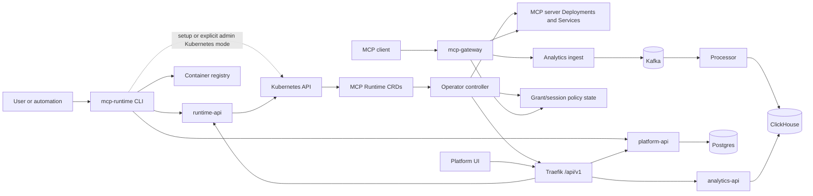
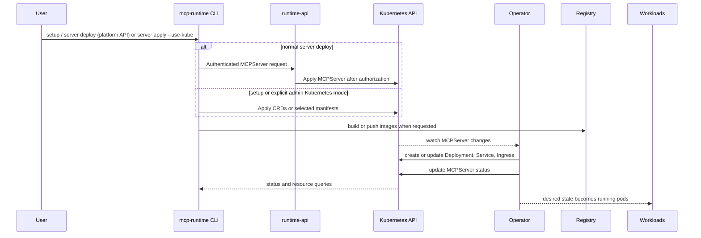
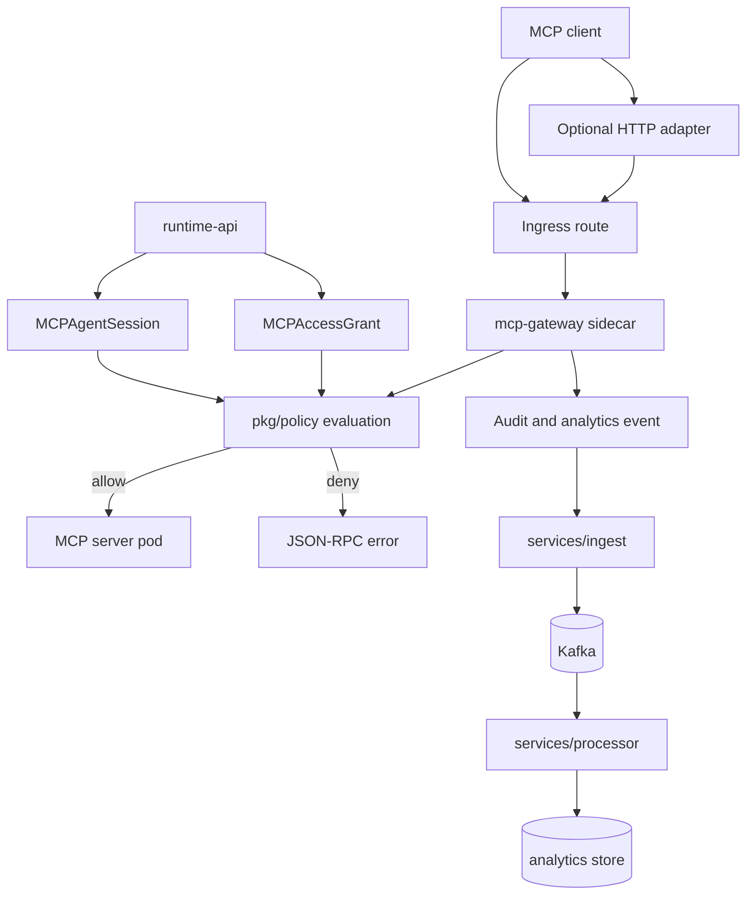

# Implementation Details

These pages describe how the MCP Runtime codebase is organized: the CLI, operator, Kubernetes API types, platform services, manifests, and tests. Read them before changing one of those areas.

For platform usage, start with the [user docs](../README.md). This section is
for contributors who need to understand package boundaries, runtime flows, and
the checks that protect each subsystem.

## Reading path

Start with [API Types](api-types.md) and [Request Flows](request-flows.md), then
follow the component involved in your change. Use
[Development and Testing](../contributor/README.md) for the local contribution loop.

| Guide group | What it covers | Entry points |
|---|---|---|
| Contracts and Flows | Resource shapes, request paths, server metadata, and manifests | [API Types](api-types.md), [Request Flows](request-flows.md) |
| Components | CLI startup and commands, operator reconciliation, and workload inventory | [CLI Implementation](cli.md), [Operator](operator.md), [Component Inventory](component-inventory.md) |
| Security and Lifecycle | Credential consumers, Secret access, rollouts, and log collector admission | [Credential Ownership](credential-consumers.md), [Operator Secret Access](operator-secret-access.md), [Dependency Rollouts](dependency-rollouts.md) |
| Developer References | Package documentation, design background, and test coverage | [Go package docs](https://docs.pkg.mcpruntime.org/github.com/mcp-runtime/mcp-runtime), [Tests and Coverage](testing.md) |

## Mental model

MCP Runtime is a Kubernetes-native control plane for MCP servers. Most changes touch one of four surfaces:

1. The CLI turns user intent into Kubernetes manifests, registry actions, cluster checks, and API calls.
2. The CRDs define the durable contract: `MCPServer`, `MCPAccessGrant`, and `MCPAgentSession`.
3. The operator reconciles those CRDs into Deployments, Services, Ingress routes, status, and policy materialization.
4. Platform services provide the runtime gateway, governance APIs, analytics ingest, processing, and UI.

## Repository map

| Area | Start here | Why it matters |
|---|---|---|
| CLI entrypoint | [`cli-entrypoint.md`](cli-entrypoint.md) | Shows how the binary starts, wires foldered Cobra commands, and reports errors. |
| CLI implementation | [`cli.md`](cli.md) | Covers the `internal/cli/root` routing layer plus setup, bootstrap, registry, server, access, adapter, auth, team, status, and platform behavior. |
| Kubernetes API types | [`api-types.md`](api-types.md) | Defines the public CRD shapes consumed by users, tests, and the operator. |
| Request flows | [`request-flows.md`](request-flows.md) | Maps CLI, UI/API, registry, adapter, MCP runtime, policy, analytics, tenancy, and pre-release paths to components and E2E scenarios. |
| Platform API services | [`../platform-services.md`](../platform-services.md) | Three-service split (platform-api, runtime-api, analytics-api): Traefik `/api/v1` routing, RBAC, `/internal/*` contracts, OpenAPI per service. |
| Go package docs | [pkgsite](https://docs.pkg.mcpruntime.org/github.com/mcp-runtime/mcp-runtime) | Browse the full source tree with package indexes, symbols, and source links. See [`pkgsite.md`](pkgsite.md) for hosting. |
| Agent adapter | `internal/agentadapter/`, `internal/cli/adapter/` | Streamable HTTP proxy behavior with session-bound client certificates; exposed via `mcp-runtime adapter proxy`. |
| Operator Secret access | [`operator-secret-access.md`](operator-secret-access.md) | Scoped tenant Secret permissions and the named public trust bundle exception. |
| Operator | [`operator.md`](operator.md) | Explains manager startup and reconciliation from desired state to Kubernetes resources. |
| Component inventory | [`component-inventory.md`](component-inventory.md) | Stable workload identity, ownership and validated namespace layout resolution. |
| Control-plane helpers | `pkg/controlplane/` | Shared MCPServer Kubernetes operations and status projection used outside HTTP/CLI glue. |
| Shared policy and events | `pkg/policy/`, `pkg/events/`, `pkg/clickhouse/` | Gateway policy contracts/evaluation plus event envelopes and ClickHouse query/insert helpers. |
| Shared infrastructure and workload helpers | `pkg/envcfg/`, `pkg/httpx/`, `pkg/transport/`, `pkg/telemetry/`, `pkg/svcboot/`, `pkg/kubeworkload/` | Configuration, HTTP primitives, transport support, observability, service startup and restricted Kubernetes workload defaults. |
| API service internals | `services/runtime-api/internal/runtimeapi/`, `services/platform-api/internal/platformstore/`, `pkg/apikit/`, `pkg/platformauth/`, `pkg/internalapi/` | Split API modules: runtime HTTP/Kubernetes orchestration, platform Postgres persistence, shared HTTP contract helpers. |
| Metadata helpers | [`metadata.md`](metadata.md) | Covers `.mcp` metadata loading, host resolution, and CRD generation helpers. |
| Manifests and examples | [`config-and-examples.md`](config-and-examples.md) | Explains Kustomize overlays, registry/ingress config, and example MCP servers. |
| Tests | [`testing.md`](testing.md) | Maps unit, golden, integration, and QA E2E coverage. |

## Control-plane flow

A normal server deployment starts in the CLI, passes through runtime-api and
the Kubernetes API, and is completed by reconciliation. Setup and explicit
admin Kubernetes mode write to Kubernetes directly.

When changing this path, check the relevant CLI command, the `api/v1alpha1` contract, the operator reconciliation code, and at least one test that proves the generated or reconciled resource shape.

## Runtime request flow

With the gateway enabled, ingress sends requests through the gateway before
they reach the application. OAuth validation applies when `spec.auth` is set;
grant/session enforcement applies to allow-list policy. Observe mode forwards
calls without those policy checks. With the gateway explicitly disabled, the
application handles authentication and authorization itself. The optional agent adapter runs beside a client that needs a local HTTP proxy; it forwards OAuth and adds identity from a verified client certificate.

Governance-related changes usually span `api/v1alpha1/access_types.go`, `pkg/access/`, `pkg/policy/`, `services/runtime-api`, `services/mcp-gateway`, `services/ingest`, and the e2e policy scenarios.

## Package dependency guide

```mermaid
flowchart TB
    Cmd[cmd/mcp-runtime] --> CLIRoot[internal/cli/root]
    CLIRoot --> CLIAdapter
    CLIAdapter[internal/cli/adapter] --> AgentAdapter[internal/agentadapter]
    CLIRoot --> CLICommands[CLI command packages]
    CLICommands --> CLICore[internal/cli/core]
    CLICommands --> Metadata[pkg/blueprint]
    CLICommands --> Manifest[internal/cli/manifest]
    CLICommands --> K8sClient[pkg/k8sclient]
    CLICommands --> Access[pkg/access]
    CmdOp[cmd/operator] --> Operator[internal/operator]
    Operator --> API[api/v1alpha1]
    Operator --> ControlPlane[pkg/controlplane]
    Operator --> Policy[pkg/policy]
    Operator --> Workload[pkg/kubeworkload]
    Operator --> K8sClient
    Operator --> Manifest
    Operator --> Access
    Services[services/*] --> Env[pkg/envcfg]
    Services --> Telemetry[pkg/telemetry]
    Services --> HTTP[pkg/httpx]
    Services --> Transport[pkg/transport]
    BrokerServices[ingest and processor] --> KafkaTrace[pkg/telemetry/kafkatrace]
    KafkaTrace --> Telemetry
    Services --> ControlPlane
    Services --> Access
    Services --> ClickHouse[pkg/clickhouse]
    Services --> Events[pkg/events]
    Gateway[services/mcp-gateway] --> Policy
    RuntimeAPI[services/runtime-api] --> Workload
    RuntimeAPI[services/runtime-api] --> RuntimeAPIPkg[services/runtime-api/internal/runtimeapi]
    PlatformAPI --> PlatformStore[services/platform-api/internal/platformstore]
    PlatformAPI --> APIAuth[services/platform-api/internal/apiauth]
    ClickHouse --> Events
    ControlPlane --> API
    ControlPlane --> K8sClient
    Metadata --> API
```

Keep shared behavior in `pkg/` only when multiple binaries or services need it. CLI top-level command routing belongs in `internal/cli/root` and `internal/cli/<command>`; CLI-only shared infrastructure belongs in `internal/cli/core`; reconciliation behavior belongs in `internal/operator`; Kubernetes-facing MCPServer operations that are reused outside the operator belong in `pkg/controlplane`; rendered gateway policy evaluation belongs in `pkg/policy`; reusable event and storage contracts belong in `pkg/events` and `pkg/clickhouse`; shared pod hardening defaults belong in `pkg/kubeworkload`; runtime orchestration belongs in `services/runtime-api/internal/runtimeapi`; platform identity, team, key, and audit persistence belongs in `services/platform-api/internal/platformstore`; API principal context helpers belong in `services/platform-api/internal/apiauth`; HTTP service glue belongs near the service that owns the endpoint unless it is repeated across services.

Shared gateway dependencies follow their owning domains:

| Package | Responsibility |
|---|---|
| `pkg/identity` | Certificate/SPIFFE identity, credential-header contracts and OAuth protected-resource URLs |
| `pkg/policy` | Policy documents, evaluation, enums/defaults and rendered policy ConfigMap naming |
| `pkg/topology` | Component placement, platform ports, namespaces and workload token audiences; the platform mode, publish scopes and catalog namespaces; public route validation and the default MCP route |
| `pkg/events` | Platform event envelopes and the typed `MCPRequest` audit payload |
| `pkg/sessionstate` | The platform-owned governance-session synchronization wire contract |

The former `credentialheaders`, `oauthresource` and `mcpdefaults` packages are
consolidated into these owners. Code can be split across files within one
package; another package needs a distinct responsibility and a useful API.
Consumer-owned interfaces stay beside the gateway code that uses them.
This follows the Go team's [package naming guidance](https://go.dev/blog/package-names)
and [module organization guidance](https://go.dev/doc/modules/layout), reviewed
2026-10-25.

Shared infrastructure has explicit owners instead of `pkg/serviceutil`:

| Package | Responsibility and dependency boundary |
|---|---|
| `pkg/envcfg` | Environment parsing and fallback semantics; standard library only |
| `pkg/httpx` | JSON response and API-path primitives; standard library only |
| `pkg/identity` | Token/header and identity contracts; standard library only |
| `pkg/transport/tlsconfig` | Existing TLS loading, validation and renewal callbacks; standard library only |
| `pkg/transport/httptrace` | Instrument existing HTTP clients and round-trippers; no exporter, Prometheus or Kafka dependencies |
| `pkg/oidcdiscovery` | Issuer metadata, redirect validation and existing discovery retry behavior |
| `pkg/telemetry` | Service tracing setup, correlated logs, request metrics and response correlation |
| `pkg/telemetry/kafkatrace` | Kafka header adaptation, imported by producers and consumers |
| `pkg/apikit` | Structured API errors, error logging and request/query validation |
| `services/runtime-api/internal/runtimeapi/access` | Grant/session action-path parsing beside its owning handlers |

The parent `pkg/transport/` directory groups transport packages; it is not an
umbrella Go package. The future HTTP factory in
[#868](https://github.com/tavric-labs/mcp-runtime/issues/868) can fit at
`pkg/transport/httpclient` without importing service telemetry or business
rules. This PR moves existing behavior; it does not implement the factory or
change client construction, budgets, redirects, proxy rules, tracing fields,
TLS behavior or stream handling. Each binary remains its composition root.
No forwarding `serviceutil` package is retained; source consumers update imports.

`TestSharedInfrastructureDependencyBoundaries` checks transitive build graphs:
foundational helpers stay standard-library only; authentication and HTTP
instrumentation stay free of exporters, Prometheus and Kafka; policy stays
free of service infrastructure; and the gateway stays free of Kubernetes and
Kafka clients. Run it through the isolated test wrapper in `test/regression`.

Shared `pkg/` packages follow a four-layer dependency rule. A package may import
its own layer or a lower one, never a higher one.

| Layer | Packages | Rule |
|---|---|---|
| Composers | `services/*`, `cmd/*`, `internal/*` (runtime-api, platform-api, operator, CLI) | Wire everything together; change most often |
| Adapters | `k8sclient`, `kubeworkload`, `registrypush`, `controlplane`, `platformstack`, `operatorutil`, `resourcehistory`, `workloadidentity`, `metadata/crdgen`, `access/k8sstore` | The only layer that imports Kubernetes libraries |
| Domain | `policy`, `access`, `sessionstate`, `metadata` | Rules and models; no Kubernetes or service infrastructure |
| Leaves | `identity`, `events`, `credentialbroker`, `envcfg`, `httpx`, `topology` and similar | Import only other leaves; most stable |

Support packages (`apikit`, `platformauth`, `telemetry`, `svcboot`, `clickhouse`)
sit beside the domain and never import adapters. The `mcp-gateway` may use
`policy`, `events` and `credentialbroker` but must not import an adapter.
`TestSharedPackageLayerDesign` enforces this and fails for an unclassified new
package. `pkg/blueprint` is Kubernetes-free: only the MCPServer CRD rendering
lives in the `metadata/crdgen` adapter. `pkg/access` is Kubernetes-free too: it
holds the grant and session specs, request contracts and validation, with its own
`access.Time` and `access.Condition` that marshal exactly like `metav1.Time` and
`metav1.Condition`. The Kubernetes object envelopes (`MCPAccessGrant`,
`MCPAgentSession` and their lists), the dynamic-client `Manager` and the
unstructured converters live in the `access/k8sstore` adapter. The only
Kubernetes import the lower layers keep is the generic field-path validation
helper, named in `k8sHelperPackages`; `k8sInDomain` is empty and a new entry
needs a written justification. Platform-specific
logic belongs in platform-api; runtime-api stays the Kubernetes-manipulation
service. Moving existing runtime-api handlers is tracked separately because it
changes the API between the two services.

MCP protocol revisions remain dated identifiers: the `2025-11-25` interaction
model and the `2026-07-28` stateless model have different transport/lifecycle
requirements. Runtime governance sessions are separate from MCP transport
sessions. The gateway observation contract retains open RPC method names and
preserves current audit fields without retaining raw params.
Full dual-revision conformance remains tracked in
[#662](https://github.com/tavric-labs/mcp-runtime/issues/662). This refactor does
not add draft MCP Events extension support. Platform audit events and
`pkg/events` are separate from that proposed extension.

## Learning path

1. Read [API types](api-types.md) first. The CRDs are the contract that every other subsystem follows.
2. Read [CLI internals](cli.md) and [cmd/mcp-runtime](cli-entrypoint.md) to see how users create, inspect, and deploy resources.
3. Read [operator internals](operator.md) to understand how `MCPServer` state becomes Kubernetes workloads and ingress.
4. Read [config and examples](config-and-examples.md), then run or inspect the example server manifests.
5. Read [request flows](request-flows.md) when a change crosses CLI, UI, API, registry, gateway, policy, analytics, or tenant boundaries.
6. Read [tests](testing.md) before making changes; it shows the fastest feedback loop and the broader CI safety net.
7. Use the change playbooks below to choose the narrowest useful tests before
   broadening to full CI coverage.

## Package Reference

These pages are contributor guides. For exported types, functions, and doc
comments, use [pkgsite](https://docs.pkg.mcpruntime.org/github.com/mcp-runtime/mcp-runtime),
which is rebuilt from `main`, or run `go doc <package>` against your checkout.
Keep the narrative internals pages focused on stable contracts and contributor
workflows.

## Change playbooks

| Change | Read first | Verify with |
|---|---|---|
| Add or change a CLI flag | `internal/cli/root`, `internal/cli/<command>`, `internal/cli/core`, `cmd/mcp-runtime`, golden CLI tests | `go test ./internal/cli/... ./test/golden/... -count=1` |
| Change a CRD field | `api/v1alpha1`, CRD YAML, operator reconciliation, docs/API reference | `go test ./api/v1alpha1/... ./internal/operator/... -count=1` |
| Change generated manifests | `pkg/blueprint`, `internal/cli/manifest`, `config/`, examples | targeted package tests plus manifest diff review |
| Change reconciliation behavior | `internal/operator`, API types, k8s helpers | `go test ./internal/operator/... -race -count=1` |
| Change governance policy | `pkg/access`, `pkg/policy`, `services/runtime-api`, `services/mcp-gateway`, access CRDs | targeted package/service tests plus e2e policy scenario |
| Change agent adapters | `internal/agentadapter`, `internal/cli/adapter`, `docs/connect-clients.md` | `go test ./internal/agentadapter ./internal/cli/adapter -count=1` |
| Change team provisioning or membership | `internal/cli/team`, `services/runtime-api/internal/runtimeapi`, `services/platform-api/internal/platformstore`, `docs/teams-and-access.md` | `go test ./internal/cli/team -count=1` plus service API tests inside `services/platform-api` and `services/runtime-api` |
| Change event storage | `pkg/events`, `pkg/clickhouse`, `services/ingest`, `services/processor`, `services/analytics-api`, `services/mcp-gateway` | package tests plus touched service tests |
| Change docs site behavior | `docs/mkdocs.yml`, `docs/nginx.conf`, Markdown pages | MkDocs build or docs container build |

## Contributor checklist

Before opening a change, confirm:

- The code follows the closest existing package pattern.
- Public behavior is reflected in `docs/`, `README.md`, or `AGENTS.md` when relevant.
- CRD changes update both Go types and generated YAML.
- CLI help changes update golden snapshots intentionally.
- Narrow tests pass for touched packages.
- Full `go test ./... -count=1 -race` is run before merge when the change touches shared behavior.
