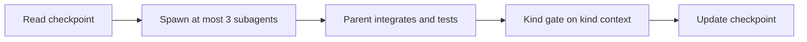

# Durable runtime migration checkpoint

Issue: https://github.com/tavric-labs/mcp-runtime/issues/873

Working log for turning `runtime-api` into an internal durable runtime. Not a published guide. Do not add this file to `docs/mkdocs.yml`.

The design lives in the [issue design comment](https://github.com/tavric-labs/mcp-runtime/issues/873#issuecomment-6465833216) (source audit: 2026-10-28 against commit `4fb845594f071212496aec4bd08c9d503612d6f9`; revision IDs and ownership accepted: 2026-10-29). This file is how a later session continues that design. Read it first. Update **Current phase**, the checkboxes, **Evidence**, and **Do not redo** before stopping.

- **Current phase:** implementation not started; revision-ID and ownership design updated 2026-10-29
- **Next task:** Phase 0 only. Characterization tests for the five flows below. No behavior change.
- **Stop rule:** a failed Kind gate or an open decision blocks the phase. Record the failure here and stop. Do not start the next phase.

## What changes, in one pass

Today `runtime-api` is both the public API and the worker. Several handlers do multi-step work inline. `platform-api` already sits on the auth path (`database/sql` + `github.com/lib/pq` in `services/platform-api/internal/platformstore/store.go`).

Target, once the gates below pass:

- `platform-api` is the only public management API. It authorizes the request and, in one Postgres transaction, writes desired state, an operation record, and a River job.
- `runtime` (today's `runtime-api`) consumes that queue, reconciles idempotently, and writes receipts back through a typed internal API. It does not get called by platform-api to accept work.
- A finished River job means one bounded step was applied. It does not mean the resource is healthy. Health comes from a separate observer.
- The existing MCP operator keeps reconciling `MCPServer` objects into workloads. Runtime applies the custom resource. It does not become a second Deployment controller.
- Kafka and ClickHouse stay the analytics path. Queue state does not move there.
- Image bytes and registry credentials never go in job arguments.

A completed job and current health are different facts. Example: revision `rev-B` is applied and the job completes, the server later becomes Ready, then a node failure marks it Degraded. The original job stays completed.

## Three ownership layers

| Layer | Owns | Writes |
|---|---|---|
| Platform API — intent | What the user is authorized to request; current desired revision and business lifecycle | Domain transactions, immutable desired revisions, operations, security authority and atomic River insertion |
| Runtime — projection | Applying current platform intent to infrastructure | MCPServer/MCPAccessGrant specifications, namespaces and other runtime-owned prerequisites; application receipts through platform internal APIs |
| MCP operator — realization | Workloads and policy derived from MCPServer specifications | Child Deployments, Services, routes, policy artifacts and CR status conditions |

Status Sync is the observation responsibility: it reads infrastructure facts and records their mapped revision, conditions and freshness through the platform internal API. It cannot change intent or authority. Runtime must not compete with the operator for its child resources. Raw managed Deployments remain a separate runtime path. Replicas within each layer still need concurrency controls.

## Revision identity and write safety

Use an opaque platform revision ID instead of a numeric platform generation. A meaningful accepted desired-state change creates an immutable revision. In one transaction, the platform creates the revision, conditionally changes the resource's `desiredRevisionId` against the expected current revision, records the operation and inserts the job. The current pointer determines desired intent; revision IDs are compared for equality, not sorted to determine the winner.

| Marker | Owner and meaning |
|---|---|
| `desiredRevisionId` | Platform API: current accepted desired state |
| `appliedRevisionId` | Runtime receipt, persisted by Platform API: exact revision accepted by the external API |
| `observedRevisionId` | Status Sync, persisted by Platform API: revision associated with fresh observations |
| Worker fencing token | Execution coordinator plus enforcing destination: rejects a stale execution owner |
| Kubernetes `metadata.resourceVersion` | Kubernetes: object concurrency and watch token; not worker ownership |
| Kubernetes `metadata.generation` | Kubernetes: desired-spec counter for the CR |
| CR `status.conditions[].observedGeneration` | Operator: CR generation evaluated by a condition; does not itself imply readiness |

For example, `desiredRevisionId=rev-B`, `appliedRevisionId=rev-A` and `observedRevisionId=rev-A` means B was accepted but application/observation still describe A. When B is applied, its receipt maps `rev-B` to the target CR UID, Kubernetes generation and specification digest. Status Sync checks that mapping and the required conditions before associating fresh health with B. No-op CR updates and coalesced platform changes need not advance Kubernetes generation.

Retries and drift repair retain the revision ID; request-idempotent retries return the same acceptance. Operation/job/attempt IDs stay separate. Rollback to old configuration creates a new accepted revision referencing those contents; a digest identifies content, not acceptance identity. Receipts are conditional on incarnation, captured revision and execution fence. IDs are neither authorization nor fencing, and a conditional database receipt does not fence a Kubernetes write. Kubernetes fields remain unchanged; no top-level CR `status.observedGeneration` or extra platform sequence is proposed.

Reviewed prior art (2026-10-29): [Knative revisions](https://knative.dev/docs/serving/revisions/) and [Crossplane composition revisions](https://docs.crossplane.io/latest/composition/composition-revisions/) identify configuration snapshots; [Lambda RevisionId](https://docs.aws.amazon.com/lambda/latest/api/API_UpdateFunctionConfiguration.html) guards conditional updates. These examples inform the proposed platform contract; they do not replace it.

## How a session runs

1. Read this file and the issue section for the current phase only.
2. Spawn at most 3 subagents. Give each a file slice from the phase, not the whole issue.
3. The parent integrates, runs tests, and is the only editor of this file.
4. Unit tests use `export KUBECONFIG=$(mktemp)` in that shell. Kind uses an explicit `kind-*` kubeconfig from the contributor-cluster skill. Never leave a production context current.
5. Pure moves stay in their own commits, separate from revision identity, status, or HTTP behavior changes.

## What the code does today

These are the flows phase 0 locks before anything moves.

**Team create** is a distributed transaction with a manual rollback. `services/runtime-api/internal/runtimeapi/teams.go` `handleRuntimeTeamCreate` calls `identity.CreateTeam`, then `Deployments().ensureTeamNamespace`. On namespace failure it calls `DeleteTeamBySlug` and returns 500. Success returns 200. `CreateTeam` in `services/platform-api/internal/platformstore/teams.go` already commits the team, namespace row, and owner membership in one transaction. A crash after that commit and before namespace provisioning leaves a team with no namespace and nothing retries. Cleanup failure is also only logged.

**Team delete** in `services/runtime-api/internal/runtimeapi/team_members.go` `handleRuntimeTeamDelete` soft-deletes the platform team first, then best-effort removes Traefik watches via `k8sprovision.RemoveTraefikDeploymentWatchesNamespace`. Watch removal failure is logged. The handler still returns 204. It does not delete the Kubernetes namespace.

**Agent deactivate** in `services/runtime-api/internal/runtimeapi/agents.go` sets the agent inactive through `SetAgentStatus`, then calls `revokeAgentSessions`. If revocation fails, the response says the agent is inactive but revocation is incomplete. Platform store deactivation of a user is a separate atomic path (`services/platform-api/internal/platformstore/agents.go`). Reactivation must not restore revoked sessions. Existing coverage: `agents_test.go` `TestDeactivateAgentRevokesOnlyMatchingSessionsAndAuditsEach`.

**Server retirement** in `services/runtime-api/internal/runtimeapi/servers.go` and `server_retirement.go` marks the server retiring, fences and revokes sessions, retires grants, removes exclusively owned credentials, then UID-conditionally deletes the custom resource. Existing coverage: `server_retirement_test.go`. A generic async delete would weaken the UID fence.

**Registry push** in `services/runtime-api/internal/runtimeapi/registry_push.go` `HandleRuntimeRegistryPush` writes a local tar (`registryPushRequest.TarPath`), registers transfer access, starts a helper, and waits. `registry_push_transfer.go` stores a local path, Pod IP, and expiry. `defer os.Remove(req.TarPath)` cleans the tar for that process. A River retry cannot recover bytes that lived only on that Pod.

**Sessions** already live in the platform store (`session_backend.go`). Kubernetes session YAML is not gateway authority. Do not queue the authoritative revoke.

## Decisions

Accepted until overridden in this section:

- Queue is River (https://riverqueue.com/), inserted with `InsertTx` on the same `*sql.Tx` as the resource write. River's `riverdatabasesql` driver is the one to prove against `lib/pq`. If that proof fails, stop. Do not add a custom outbox or move control-plane work onto Kafka.
- Runtime's database role can read and update River tables only. Domain tables stay behind platform-api internal APIs.
- Team delete keeps today's cleanup: Traefik watches only. Namespace and user data stay.
- Jobs carry kind, resource id, incarnation, target cluster, requested revision ID, operation id, and trace correlation. They do not carry passwords, tokens, private keys, registry credentials, or archives.
- Platform desired state uses opaque revision IDs with immutable contents and a transactional current pointer, as specified above. No numeric platform generation is required. Preserve Kubernetes version fields and separate execution fencing.
- The operator is not folded into the runtime reconcile loop. Share only a small helper if a later phase shows a real one.

Still open. The phase that needs the answer does not start until the answer is written here:

- **Phase 1 cutover.** Keep the accepted team and surface provisioning failure with a retry, instead of deleting the team. Needs an explicit yes before `handleRuntimeTeamCreate` changes. Until then the handler stays synchronous.
- **HTTP and wait.** Per endpoint: keep 200, or use 201 with pending status, or 202 for an operation. What `--wait` and `--no-wait` wait for. Team create is 200 today, so this is an API decision.
- **Phase 3 staging.** Install-supported persistent volume versus object storage. Retention, capacity, and what happens when two publications target one mutable tag. A per-Pod filesystem, `emptyDir`, or a path inside a Secret does not count as durable.
- **Phase 5 grants.** How a disabled or deleted grant becomes a deny on already-serving gateways. Queuing deletion of a custom resource is not an immediate deny. Separate committed authority, projection applied, and propagation verified.
- **Budgets.** Retry cap, jitter, max delay, observation freshness, and per-tenant queue limits. Fill these from the phase 1 Kind measurements, not from River's defaults alone.
- **Rename** waits for phase 6. Module `mcp-runtime-api`, image, Deployment, NetworkPolicy, RBAC, and docs move together, after no caller still uses the public management routes.

## Phases

### Phase 0 — Characterize

- [ ] Not started
- No behavior change. Kind is not required.
- Subagent A: team create rollback and team delete. Subagent B: agent deactivate, server retirement order, registry push local tar. Parent runs the tests.

Lock these outcomes on the current code:

- [ ] Namespace provisioning failure deletes the team and returns 500. If that delete also fails, the handler still returns 500 and both calls happened.
- [ ] Team delete returns 204 after the platform delete even when Traefik watch removal fails. The namespace object is not deleted.
- [ ] Deactivate revokes only sessions for that agent and team, writes one audit per revoked session, and does not un-revoke on reactivate.
- [ ] Retirement order stays: retiring marker, session and grant fence, owned credential cleanup, UID-conditional custom-resource delete. A shared pull secret is kept.
- [ ] Registry push stages a local tar path and removes it when the handler returns. The test must not require a live cluster.

Gate command, from the repo root, after `export KUBECONFIG=$(mktemp)`:

`go test -count=1 ./services/runtime-api/internal/runtimeapi/ -run 'TeamCreate|TeamDelete|DeactivateAgent|Retirement|RegistryPush'`

Also run any new platform-store test the agent-deactivate characterization needs. Record the exact test names in **Evidence**.

### Phase 1 — Team spike

- [ ] Blocked on phase 0 and on a written yes for the team-create failure semantics
- Two coding subagents, then one Kind pass.
- Subagent A: pin River in `services/platform-api`, prove `InsertTx` on the `CreateTeam` transaction, add the migration role for River DDL. Subagent B: internal desired-team, receipt, and status APIs plus the reconcile worker. Parent wires two replicas and runs Kind.

Work:

- Extend the team transaction in `services/platform-api/internal/platformstore/teams.go` and `schema.go` so the team row, namespace desired status, operation row, and River job commit together or not at all.
- Job kind `reconcile_team`. The worker loads current intent, supersedes obsolete accepted operations, skips deleted/replaced teams, and reconciles the current desired revision using the existing namespace provision path (`ensureTeamNamespace` in `services/runtime-api/internal/runtimeapi/deployments.go`) idempotently.
- Status is separate from the job: `pending`, `ready`, or `error`, with attempt count and last error.
- Two worker replicas. Claim safety comes from River, not a second lease table.
- Trace: persist the request id from the API call onto the operation. A later attempt gets a new span. Do not hold the HTTP span open across retries.

Kind gate, explicit `kind-*` context:

- [ ] Kill the API after commit and before the HTTP response. One team row, one job, idempotent client retry finds the same operation.
- [ ] Roll the transaction back. Neither the team nor a runnable job is visible.
- [ ] Scale runtime to zero for a while. The team stays pending, queue age increases, then one namespace appears after recovery.
- [ ] Timeout from the Kubernetes API after a successful namespace create. Replay uses the same namespace and does not create a second one.
- [ ] Create races delete. The old create does not recreate the namespace. Cleanup does not delete a replacement.
- [ ] A delayed worker for a superseded revision cannot record `appliedRevisionId` for a different current revision.
- [ ] Request-idempotent retry returns the same revision/operation. Worker retries and drift repair retain that revision; a completed job does not suppress later repair.
- [ ] Rollback to prior contents creates a new acceptance revision; delayed receipts for the previous acceptance cannot satisfy it.

Stop if `*sql.Tx` insert with `lib/pq` fails. Record the River version and the error here. Do not start phase 2 on a broken queue.

### Phase 2 — Platform owns directory commands

- [ ] Blocked on phase 1
- Two subagents, overlapping the end of phase 1. One moves handlers and store calls. One updates OpenAPI, authz, and CLI goldens.
- Move team, membership, agent, and namespace commands and scoped reads onto platform-api. Runtime keeps infrastructure follow-up only.
- Preserve atomic user-plus-membership create (`CreateTeamUser`) and the agent-inactive plus session-revoke transaction. Membership removal is not account deactivation.
- Personal workspace counts and admin counts stay separate. Anonymous catalog reads stay limited to public namespaces.
- Gate: platform-api OpenAPI contract test, authz matrix, CLI goldens under `test/golden/cli/testdata/`, and a Kind smoke that creates a team and lists it. Record the commands in **Evidence**.

### Phase 3 — Registry recovery

- [ ] Blocked until **Decisions** names the staging backend, retention, and mutable-tag rule
- Two subagents. One owns upload and finalize. One owns the helper identity and digest check. Use a separate Kind window from ordinary team tests so image pulls do not queue behind them.
- Upload lifecycle is `uploading`, then `finalized`, or `aborted` / `expired`. A job is inserted only after the bytes are durable and the publication row commits. A crash before that commit leaves an unreferenced artifact for garbage collection.
- Helper name is derived from the publication id. A crashed worker resumes that helper instead of creating another. If the registry already has the manifest, verify the digest and finish the same publication.
- Native OCI client push and registry auth stay on their current path.
- Namespace pull credentials stay a separate reconcile step. The job row never contains the credential value.
- Gate: kill the uploader, the API, and the worker after finalize. Another replica reads the same bytes. A partial upload does not enqueue. Two publications of one tag follow the rule written above.

### Phase 4 — Servers and raw deployments

- [ ] Blocked until phase 1 revision-conditional receipts and execution fencing have passed on Kind
- Three subagents: `ReconcileServer` (`servers.go`), raw Deployment/Service apply (`deployments.go` around the upsert path), and the status observer.
- Platform accepts an immutable desired server revision and updates `desiredRevisionId` in one transaction with the operation and job. The worker applies the `MCPServer` custom resource with UID and resourceVersion preconditions. The operator still owns child Deployments.
- Receipt stores `appliedRevisionId`, target UID, Kubernetes generation, and spec digest. Observer stores `observedRevisionId`, revision-tagged platform conditions and freshness. Map the platform revision to the CR identity/spec/generation; preserve operator conditions' Kubernetes `observedGeneration`.
- A node failure or `ImagePullBackOff` updates health to degraded and does not enqueue another apply. A missing desired custom resource does enqueue one repair. An operator-owned Deployment disappearing does not.
- Raw Deployment and Service upserts become `ReconcileDeployment`. They do not go through the MCP operator.
- Publication-dependent deploy waits until phase 3 has passed. Deploy by verified digest once that phase exists.
- Gate: apply job is completed while status is still progressing. Later node loss flips health only. Replacing a server with a new UID does not satisfy Ready from the old object. Delete uses the UID precondition so cleanup cannot remove the replacement.

### Phase 5 — Grants and enrollment

- [ ] Blocked until **Decisions** says how serving gateways observe a deny
- Two subagents. One for grants, one for certificate enrollment (`adapter_certificate.go`).
- Do not put session revoke or agent deactivation authority into River. Those commits stay synchronous. A follow-up job may audit or project. A failed follow-up is not evidence that the revoke failed.
- Grant states to keep distinct: revocation committed, projection applied, propagation verified. Unknown replicas are not counted as acknowledged.
- Enrollment: one operation keyed by session UID, server UID, and CSR identity. The private key stays on the client. Persist the `CertificateRequest` name. Re-check session, agent, and server authority before activation. A delayed job must not un-revoke.
- Gate on Kind: an allowed tool call, a denied call, revoke during replica churn, and a retried enrollment that finds the original CSR instead of creating a second one.

### Phase 6 — Internalize and rename

- [ ] Blocked on phases 1 through 5
- Two subagents. One removes public management routes and updates wiring. One renames module, image, Deployment, NetworkPolicy, and RBAC, then docs.
- Do this only after no remaining caller uses the removed routes. Logs, metrics, Grafana, resource-history scrape, and registry byte streams keep their own bounded paths. They do not become River jobs.
- Startup network-policy sweep stays until a replacement gate has the same evidence.
- Changelog entry under `Unreleased`, plus the fresh-setup note if the release is a breaking `0.x` minor. This work does not authorize a reset of the hosted reference platform.
- Gate: fresh Kind install, login, team, server, grant, session, one allowed call, one denied call. Record the kubeconfig path and the commands here.

## Evidence

- 2026-10-29: documentation-only amendment accepts platform revision IDs and explains the three ownership layers. Updated the design comment and this checkpoint; source audit baseline unchanged. No implementation, unit tests, River version, Kind acceptance or production changes for this migration.
- Verification: issue description and design comment read back exactly match the reviewed drafts. Stale platform-generation terminology, JSON revision examples, preserved source links, Markdown fences and whitespace checks passed. Kubernetes generation/resourceVersion and condition-level observedGeneration remain distinct from platform revision identity and worker fencing.

When a phase finishes, append:

- Date
- Commit SHA
- Test command and result
- Kind context name, if any
- What failed and was left blocked

## Do not redo

The revision-ID/ownership design decision is accepted. Preserve the distinction between platform revision identity, Kubernetes version fields and worker fencing. Phase 0 characterization and all implementation gates remain unstarted.
