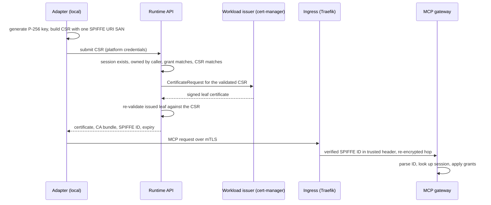

# How MCP Runtime uses SPIFFE for agent identity

**Audience:** platform operators, security reviewers and contributors who want
to know what an agent's identity *is* in MCP Runtime, how it is minted and
checked, and where its guarantees stop.
**Prerequisites:** [Identity and Authorization](identity-and-authorization.md)
for the governance model and [Client Connections](connect-clients.md) for the
adapter commands.

## The short version

When an agent talks to an MCP server through the adapter, it proves who it is
with a short-lived X.509 client certificate. The certificate carries exactly one
[SPIFFE ID](https://spiffe.io/docs/latest/spiffe-about/spiffe-concepts/#spiffe-id)
that names one platform **session**:

```text
spiffe://<trust-domain>/ns/<namespace>/session/<session>
```

The gateway never trusts headers the agent sends about itself. It reads the
SPIFFE ID from the verified certificate, looks that session up in the platform's
session store, and applies the grants bound to it. SPIFFE gives us a standard,
well-specified name and a standard place to carry it (the certificate's URI
SAN). Everything about who may do what stays in platform policy.

## Why a session, not an agent

The identity is **session-bound**. A human (or team member) starts a session for
an agent against a server, the platform stores it with an expiry, and the
certificate is bound to that session. Consequences:

- The certificate answers "which authorized session is this call part of?" and
  the session record answers "which human, agent and team, with which grants?".
- Revoking or expiring the session ends the identity, even if the certificate
  has not expired yet, because the gateway re-resolves the session on requests.
- There is no durable per-agent or per-workload SPIFFE identity. An agent that
  runs tomorrow gets a new session and a new certificate. This is deliberate for
  v1; durable identities would need their own lifecycle and revocation story.

## Lifecycle of an identity



1. **Enrollment.** The adapter generates the private key locally. The key never
   leaves the machine; only a CSR is sent. The CSR's only SAN is the session's
   SPIFFE ID (`identity.BuildSessionCSR`).
2. **Validation before signing.** The runtime API recomputes the expected ID from
   the trust domain it was configured with plus the namespace and session in the
   request, and accepts the CSR only if it carries *exactly* that URI and
   nothing else: no DNS, email or IP SANs, and no hidden `otherName` or
   `directoryName` entries in the raw SAN extension (`identity.ValidateCSRPEM`).
3. **Signing.** The platform submits the validated request to the configured
   workload issuer. Production setup requires a dedicated issuer whose approval
   policy only allows the session URI shape (see
   [Enterprise mTLS and SPIFFE](connect-clients.md#enterprise-mtls-and-spiffe)).
4. **Verifying the result.** The platform and the adapter both re-check the
   issued leaf instead of trusting the issuer: one URI SAN equal to the
   expected ID, a non-CA, client-auth-only certificate bound to the CSR's key,
   and a lifetime within the session (`identity.ValidateIssuedCertificatePEM`).
   Certificates are capped at 24 hours and never outlive the session.
5. **Renewal.** A long-running adapter enrolls a replacement before expiry. It
   renews the *same* session, so a background retry cannot extend user consent.

## What happens on each request

1. **Ingress verifies the certificate.** Traefik terminates mTLS with
   `VerifyClientCertIfGiven` against the platform workload CA. A tiny middleware
   (`traefik-plugins/spiffe-identity`) deletes any client-supplied copy of the
   verified-identity header, then, only for a verified chain, injects the
   certificate's SPIFFE ID.
2. **The hop to the gateway is authenticated.** The gateway requires a verified
   mTLS connection before it reads the header and can pin the ingress's own
   SPIFFE URI. A NetworkPolicy keeps other pods from reaching the gateway port.
   Both halves are needed: the header is only as trustworthy as the channel.
3. **The gateway parses the ID strictly.** `identity.ParseSessionSPIFFE` accepts
   only `spiffe://<configured trust domain>/ns/<namespace>/session/<name>`.
   Anything else is `invalid_spiffe_identity`.
4. **Session and grant policy decide.** The `(namespace, session)` pair becomes a
   single qualified reference and is looked up in the synchronized platform
   session cache. The session must exist, not be revoked or expired, and agree
   with the human, agent and team it was issued for. Allowed and denied calls
   are then decided by the session's grants.

## Where go-spiffe fits

Parsing and building identities used to be hand-written `net/url` code. It is
now delegated to
[`go-spiffe/v2/spiffeid`](https://pkg.go.dev/github.com/spiffe/go-spiffe/v2/spiffeid),
the reference Go implementation of the SPIFFE ID specification:

| Operation | Implementation |
|---|---|
| Mint an ID | `spiffeid.FromSegments(trustDomain, "ns", ns, "session", name)` in `identity.SessionSPIFFEID` |
| Parse and validate a header or SAN | `spiffeid.FromString` / `spiffeid.FromURI` |
| Trust domain check | `id.MemberOf(trustDomain)`, an exact match, not a string comparison |
| Pin the ingress identity | `CertificateHasURI` parses the configured pin with `spiffeid.FromString` and compares IDs, so an invalid pin never matches |
| Extract components | `id.Path()` split into exactly four segments |

Using the library means we no longer maintain our own interpretation of what a
valid SPIFFE ID is. It rejects, for us:

- any scheme other than `spiffe`, and any userinfo, port, query or fragment;
- empty segments, `.` and `..` segments, and trailing slashes;
- trust domains with uppercase letters or characters outside the spec;
- path characters outside `A-Z a-z 0-9 . - _`, including percent-escapes.

The last two are stricter than the previous hand parser, which matched the trust
domain case-insensitively and percent-escaped odd characters in namespace and
session names. Now such names are refused at issuance
(`SessionSPIFFEID` returns an error) rather than escaped. Kubernetes namespace
names and platform session names already fit the allowed alphabet, so valid
deployments are unaffected, and the gateway still **fails closed** on anything it
cannot parse.

Two deliberate boundaries remain:

- `pkg/identity` stays a leaf package. The architecture test
  `TestSharedInfrastructureDependencyBoundaries` allows exactly one third-party
  import, `spiffeid`, which itself has no dependencies.
- The Traefik middleware is a separate module executed by Yaegi and does a small
  scheme/trust-domain check on its own. It is a filter, not the authority: the
  gateway re-parses every ID with go-spiffe and checks it against policy.

## What this does and does not protect

| Property | How it holds |
|---|---|
| An agent cannot claim another session | The ID comes from a certificate signed only after the platform checked ownership, and the gateway ignores caller-supplied identity headers. |
| A stolen header is useless | Only the verified ingress hop is trusted; direct connections without a verified chain are rejected before the header is read. |
| A malformed or confusable ID is not accepted | go-spiffe validation plus an exact trust-domain and path-shape match; failure denies. |
| A leaked certificate is short-lived | 24-hour cap, tied to the session expiry, and revoking the session denies it immediately. |
| The issuer cannot be abused to mint arbitrary IDs | Dedicated issuer with an approval policy limited to the session URI shape; leaves are re-validated after signing. |

It does **not** give you:

- a durable identity for an agent or workload across sessions;
- authorization on its own. A valid certificate for an active session still
  needs a grant for the specific server and tool;
- protection if the ingress or the gateway's network isolation is bypassed, since
  the gateway trusts the header from the ingress hop;
- a replacement for OAuth. The certificate identifies the Runtime caller; OAuth
  access tokens for upstream services are a separate mechanism.

## Operating and debugging

- Set `MCP_TRUST_DOMAIN` to a **lowercase** trust domain. Production also needs
  a dedicated workload issuer (`MCP_SETUP_MTLS_CLUSTER_ISSUER`).
- A gateway denial with reason `invalid_spiffe_identity` means the header did not
  parse as `spiffe://<trust-domain>/ns/<ns>/session/<name>` or used a different
  trust domain than the policy's `auth.trustDomain`.
- `adapter enroll` or the certificate endpoint failing with an error mentioning
  the session SPIFFE ID means the namespace or session name falls outside the
  SPIFFE alphabet, or the trust domain is not valid.
- To inspect a certificate's identity, print its URI SAN locally, for example
  `openssl x509 -in client.crt -noout -ext subjectAltName`. Never print the key.

## Source map

| Concern | Where |
|---|---|
| Build and parse session IDs | `pkg/identity/session.go` |
| CSR and issued-certificate validation | `pkg/identity/csr.go` |
| Certificate URI helpers | `pkg/identity/certificate.go` |
| Issuance endpoint | `services/runtime-api/internal/runtimeapi/adapter_certificate.go` |
| Gateway authentication | `services/mcp-gateway/filter_auth.go` |
| Ingress middleware | `traefik-plugins/spiffe-identity/` |
| Renewal | `internal/cli/adapter/service_renewal.go` |
